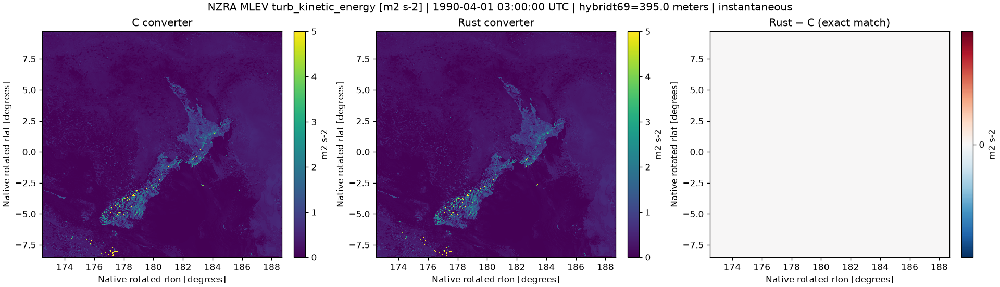
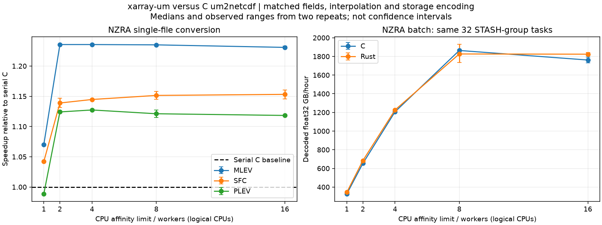

# xarray-um

Open Unified Model fields files directly in xarray, with lazy Rust-backed decoding:

```python
import xarray as xr

ds = xr.open_dataset("path-to-um-file.um", engine="um", chunks={})
```

This package targets **NZRA UM fields files**, Linux x86-64 and CPython
**3.12 or 3.13**. It is not a general reader for every UM format or grid.
Decoding supports unpacked and WGDOS-packed fields, supported byte orders and
word sizes, missing-value masks, selected fields/levels and rotated grids.
The validation section below records the tested NZRA samples and known
representation differences.

## Install with Pixi

Download the wheel matching your Python version from
[GitHub Releases](https://github.com/Tristanjmeyers/xarray-um/releases).
Install its versioned URL into an existing Pixi environment. For example, for
CPython 3.13 and the portable v0.2.0 release wheel:

```bash
pixi add --pypi 'xarray-um @ https://github.com/Tristanjmeyers/xarray-um/releases/download/v0.2.0/xarray_um-0.2.0-cp313-cp313-manylinux2014_x86_64.manylinux_2_17_x86_64.whl'
pixi run python -c 'import xarray as xr; print(xr.backends.list_engines())'
```

For CPython 3.12 use the `cp312-cp312` wheel. Copy the exact URL from the release
if its platform tag differs. Wheels include the native extension and default
NZRA STASH XML; researchers do not need a Rust compiler. The package is not yet
published on PyPI. No explicit `import xarray_um` is required to register `um`.

## Select fields and levels

```python
ds = xr.open_dataset(
    "nzra_mlev_1990020100-utc.um",
    engine="um",
    variables=["turb_kinetic_energy"],
    levels={"Theta_1_70": [10, 20]},
    grid="native",
    chunks={},
)
```

Alternatively use `stash_codes=[3473]` to include available aggregation variants;
do not supply both selectors. Pressure selections use Pa; model-level domains
use their native level numbers; `HEIGHTS` uses geometric height in metres, and
`ATM_SOIL` uses soil-depth values. Unspecified domains retain all levels.
Unavailable values fail rather than selecting a nearby level. Surface tiles
retain their independent UM pseudo-level IDs.

`grid="native"` retains staggered grids. `grid="thermodynamic"` explicitly
interpolates supported wind fields onto thermodynamic points, matching the
converter convention. This is a scientific operation, not just a format change.
The native decoder does not introduce additional quantisation or compression;
original archive precision still limits the data. The direct reader preserves
float64 unpacked values. Float32 CLI export uses the source missing indicator
as its fill value: values that round onto that indicator become masked, matching
the C converter’s float32 output convention.

## Understand coordinates

Time axes are named `time0`, `time1`, etc., deterministically in STASH/processing
order. Fields share an axis only when timestamps and scientific time metadata,
including reporting bounds, agree. Means/minima/maxima with identical intervals
can share an axis; different intervals ending at the same instant cannot.
There are no hash suffixes on these dimension names. Opening a different field
subset can change which axis receives a particular number: inspect each field's
dimensions or CF axis attributes rather than assuming a fixed axis number.

`hybridt69`, `hybridt70` and `hybridr70` represent different theta/rho model-level
sets, expressed as **reference heights** from the UM level constants. They are
not a terrain-dependent three-dimensional physical-height field.
`hybridt69_model_level`, for example, is a dimensionless auxiliary coordinate on
that height axis containing the native model-level numbers. It does not add
another dimension or duplicate the field. Both representations are retained:
use height coordinates for height indexing and the auxiliary model-level
coordinate to identify native levels. Rho model-level numbers may be fractional.
Two vertical axes are shared only if both their heights and native-level maps
agree. Other genuinely distinct axes receive readable numbered suffixes.

Geographic latitude/longitude auxiliaries are lazy and belong to their native
grid. Their internal names may still use stable grid identifiers. Aggregated
fields retain time bounds and `cell_methods` metadata.

## Parallel reads and NetCDF export

Rust releases the Python GIL and uses independent positioned reads. Dask can
schedule independent horizontal time/level planes across threads or processes:

```python
plane = ds.turb_kinetic_energy.isel(time0=0)
result = plane.compute(scheduler="threads", num_workers=4)
ds.close()
```

Set workers to your actual allocation. Use PBS or another allocated compute
session for substantial data processing on an HPC; do not infer capacity from
the login node's host CPU count.

A converter-compatible command is also available:

```bash
pixi run xarray-um input.um -c /path/to/stash.xml -s 3473 -o output.nc
```

The CLI writes float32, compressed NetCDF for converter compatibility, and
refuses to overwrite an existing output. Its `-i` flag enables interpolation.
Use `--workers 8` to decode planes concurrently while one writer owns the
NetCDF file. At most twice the worker count of planes is queued; increasing
workers can plateau when compression or storage dominates.

For independently compressed STASH-group files:

```bash
pixi run xarray-um nzra_mlev_1990040100-utc.um -i --workers 8 \
    --layout stash -o extracted/
```

This writes names such as `extracted/nzra_mlev_1990040100-utc_3473.nc`,
retaining the source stem. Each file contains the STASH code’s available
aggregation variants. Separate processes each own one writer and use one
decoder thread. `manifest.json` appears only after all groups complete; failures
return a nonzero exit and retain completed files plus `failure.json`.
Both layouts refuse existing destinations. Worker count defaults to **1**;
set it explicitly to the allocated CPU budget, not the host CPU count.
`bin/um2netcdf` provides the existing workflow-shaped wrapper without replacing
any installed system converter.

## Custom metadata

The installed package includes an NZRA STASH-to-CF mapping. Override it with
`stash_xml="/path/to/mapping.xml"`, or an explicitly selected TOML configuration:

```toml
[metadata]
stash_xml = "/path/to/mapping.xml"
```

Pass `config="/path/to/xarray-um.toml"` to the backend. A file named
`xarray-um.toml` in the current directory is also discovered; relative XML paths
are resolved against that configuration. XML identity is recorded in dataset
attributes. Unknown STASH codes retain explicit fallback names rather than
invented scientific definitions.

## Compatibility and performance

Version 0.2.0 compared every field, time and level in three staged NZRA UM files
against C `um2netcdf` 3.2.2: **134 fields were numerically exact and 1
was within `rtol=1e-6, atol=0`**, with no missing-mask mismatches. This evidence
covers these samples; archive-wide and other UM-format compatibility remain
outside that validation.



The plots use native rotated coordinates. Geographic auxiliaries in the C
reference disagree with its own CF projection; xarray-um retains independently
checked CF coordinates. Float32 time encoding and tile labels are compared with
explicit representation rules. See the [methods and limitations](docs/validation/README.md).



Medians from two repeats; the chart shows observed ranges. Serial C took
**450.2 seconds** for the selected MLEV workload. Batch
comparisons use the same 32 STASH-group tasks and equal CPU/process limits.
Workers are constrained by CPU affinity inside one PBS allocation; they are
logical CPUs, with physical cores preferred before SMT siblings.

| Workers | MLEV Rust seconds | Speedup vs serial C | Batch C seconds | Batch Rust seconds | Batch speedup |
|---:|---:|---:|---:|---:|---:|
| 1 | 420.7 | 1.07× | 590.0 | 561.0 | 1.05× |
| 2 | 364.4 | 1.24× | 295.1 | 282.0 | 1.05× |
| 4 | 364.4 | 1.24× | 159.9 | 157.3 | 1.02× |
| 8 | 364.6 | 1.24× | 103.5 | 105.6 | 0.98× |
| 16 | 365.8 | 1.23× | 109.5 | 105.8 | 1.04× |

Compression, precision, interpolation, chunks and fill conventions match.
Linked library builds differ, so these are measurements of the complete
installed export pipelines. Additional threads can plateau at compression or
storage. Archive hydration and queue waiting are excluded.

[SFC maps](docs/validation/v0.2.0/sfc_comparison.png) ·
[PLEV maps](docs/validation/v0.2.0/plev_comparison.png) ·
[Point time series](docs/validation/v0.2.0/point_series.png) ·
[All scaling results and GB/hour](docs/validation/v0.2.0/scaling.md) ·
[Per-field differences and units](docs/validation/v0.2.0/field_comparison.csv) ·
[Machine-readable provenance](docs/validation/v0.2.0/summary.json)

## Development and releases

For architecture, scientific invariants and portable HPC guidance, see
[AGENTS.md](AGENTS.md).

```bash
git clone https://github.com/Tristanjmeyers/xarray-um.git
cd xarray-um
pixi install --locked
pixi run test
pixi run build
```

Development needs the Rust toolchain; the Pixi project provides it. After Rust
changes, use `CARGO_BUILD_JOBS=2 pixi reinstall xarray-um`. Python package imports
use `xarray_um`, the distribution is `xarray-um`, and the backend name is `um`.

The release workflow builds Linux x86-64 wheels for Python 3.12/3.13 plus a source
distribution. It checks archive contents and installs each wheel in a clean Pixi
environment outside the source checkout before running synthetic checks. A
version tag such as `v0.2.0` publishes the verified artifacts to GitHub Releases.
Source installs through Pixi are also possible but require a Rust compiler:

```toml
[pypi-dependencies]
xarray-um = { git = "https://github.com/Tristanjmeyers/xarray-um.git", tag = "v0.2.0" }
```

## Licence and attribution

GPL-3.0-or-later; see [LICENSE](LICENSE). The Rust UM/WGDOS implementation derives
from Mark Cheeseman's NIWA `um2netcdf` (2014):
https://github.com/adeytown/um2netcdf . The bundled STASH mapping preserves its
original authorship comments. See [NOTICE](NOTICE) for attribution and scope.
